<div align="center">



<br/>


<br/><br/>

<a href="https://t.me/Deny_kamrad_smeshnyavy"></a>
<a href="https://t.me/WeekDaysSmeshnyavy"></a>
<a href="https://open.spotify.com/user/cgd7kum73cyouiljqlogjikh7?si=c606775b542d4966"></a>


</div>

```text
                              ==Phrack Inc.==

               Volume 0x45, Issue 0x01, Phile #0x01 of 0x07

|=-----------------------------------------------------------------------=|
|=--------------=[ K A M R A D    S M E S H N Y A V Y ]=-----------------=|
|=-----------------------------------------------------------------------=|

  0x01  Introduction ................................................ kamrad
  0x02  Arsenal: tools of the trade ................................. kamrad
  0x03  Recon: static analysis of ./kamrad .......................... kamrad
  0x04  Disassembly of self ......................................... kamrad
  0x05  Telemetry ................................................... kamrad
  0x06  Greetz & EOF ................................................ kamrad
```



```text
--[ 1 - whoami

    Malware researcher, reverse engineer and low-level developer.

    I don't create malware. I dissect it.
    I don't break systems. I understand how they break.
    Low-level is not a skill level -- it's where the real code lives.

--[ 2 - current research

    [*] malware analysis   :: unpacking, anti-debug bypass, C2 config extraction
    [*] reverse engineering :: PE / ELF internals, packers, obfuscation
    [*] GNU/Linux          :: kernel internals, syscalls, tracing
    [*] tooling            :: Rust, C and x86-64 assembly

--[ 3 - fun fact

    `rm -rf /` doesn't work without `--no-preserve-root`.
```

> *"This is our world now... the world of the electron and the switch, the beauty of the baud."*
> — The Mentor, *The Conscience of a Hacker*, Phrack #7



<div align="center">


<br/><br/>


</div>

<details>
<summary><code>$ objdump -d ./skills.bin</code></summary>

```nasm
; ===============================================
; DISASSEMBLY OF skills.bin
; Architecture: x86-64 | ARM64 | AVR
; ===============================================

section .data
    arsenal:
        languages       db "C, C++, Rust, Python, x86-64 ASM, ARM64, AVR ASM"
        scripting       db "Bash, Nushell, Lua, Nix, JavaScript"
        markup          db "HTML, CSS, JSON, Markdown"

    tools:
        analysis        db "IDA Pro, Ghidra, radare2, x64dbg, gdb"
        monitoring      db "Wireshark, tcpdump, strace, ltrace, procmon"
        frameworks      db "pwntools, angr, Burp Suite"

    platforms:
        primary         db "GNU/Linux (Arch, Debian, NixOS)"
        secondary       db "Windows (for malware sandboxing)"
        editors         db "Neovim, VS Code"

    databases:
        storage         db "SQLite, PostgreSQL, Firebase"

section .text
    global _start
_start:
    mov rax, 0x1337
    lea rdi, [rel arsenal]
    call analyze_sample
    jmp _start              ; never stop learning
```

</details>



<div align="center">

</div>



<div align="center">

</div>



<div align="center">


<br/><br/>

<picture>
  <source media="(prefers-color-scheme: dark)" srcset="https://raw.githubusercontent.com/KamradSmeshnyavy/KamradSmeshnyavy/output/github-snake-dark.svg"/>
  <source media="(prefers-color-scheme: light)" srcset="https://raw.githubusercontent.com/KamradSmeshnyavy/KamradSmeshnyavy/output/github-snake.svg"/>
  
</picture>

</div>



<div align="center">

</div>
